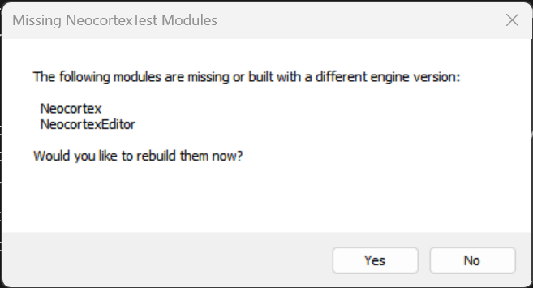
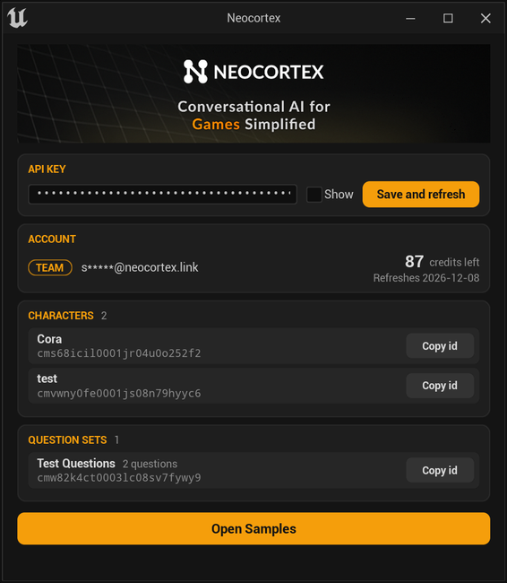
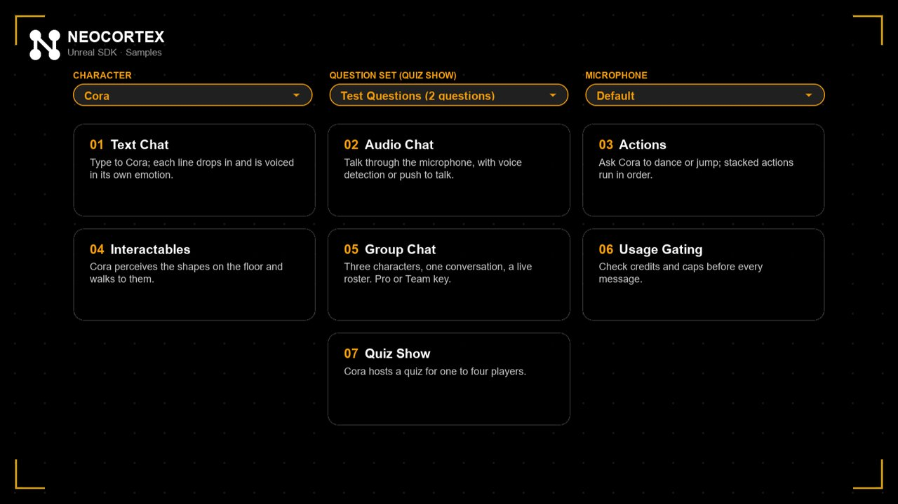
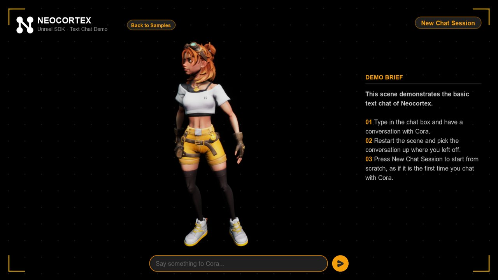
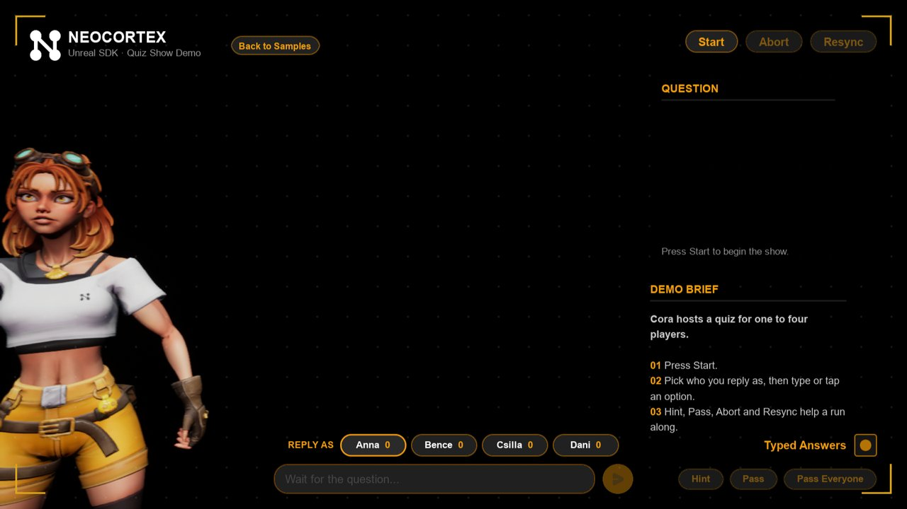

# Neocortex Unreal SDK

Smart NPCs and virtual assistants for Unreal Engine: characters that chat by text and voice, act on what they say, see the objects around them, talk in groups and host quizzes, with lip sync and ready-made UI.

## Requirements

- Unreal Engine 5.0 or later (tested on 5.0 and 5.8)
- A C++ project. The plugin ships as source and is compiled with your project. To turn a Blueprint-only project into a C++ project, add any class with **Tools > New C++ Class**.
- A C++ toolchain for your engine version: Visual Studio on Windows, Xcode on macOS
- A Neocortex account and API key from the [Neocortex Dashboard](https://neocortex.link/dashboard/api-keys)

---

## Installation

### 1. Get the plugin
Put the plugin in a folder named `Neocortex` inside your project's `Plugins` folder. Either way works:

**Download a release.** Open the [Releases](https://github.com/neocortex-link/neocortex-unreal-sdk/releases) page, download **Source code (zip)** from the latest release, unzip it into `YourProject/Plugins/` and rename the unzipped folder (for example `neocortex-unreal-sdk-0.4.0`) to `Neocortex`.

**Or clone it with Git:**
```text
cd YourProject
mkdir Plugins
cd Plugins
git clone https://github.com/neocortex-link/neocortex-unreal-sdk Neocortex
```

Your project should then look like this:
```text
YourProject/
├── Config/
├── Content/
├── Plugins/
│   └── Neocortex/
│       ├── Neocortex.uplugin
│       ├── Content/
│       └── Source/
├── Source/
└── YourProject.uproject
```

### 2. Open the project and rebuild
Open `YourProject.uproject`. The editor says some modules are missing or built with a different engine version and asks to rebuild them: choose **Yes**. The first build can take a few minutes. A plugin in the project's `Plugins` folder is enabled on its own, so no file needs editing.



If the rebuild fails, build from your IDE instead: right-click the `.uproject` file, choose **Generate Visual Studio project files** (Windows) or **Generate Xcode project** (macOS), open the generated solution and build the `YourProjectEditor` target. From the command line:

Windows:
```text
"C:\Program Files\Epic Games\UE_5.x\Engine\Build\BatchFiles\Build.bat" YourProjectEditor Win64 Development "path\to\YourProject.uproject"
```

macOS:
```text
"/Users/Shared/Epic Games/UE_5.x/Engine/Build/BatchFiles/Mac/Build.sh" YourProjectEditor Mac Development "path/to/YourProject.uproject"
```

### 3. Check the installation
In **Edit > Plugins**, **Neocortex Unreal Engine SDK** is listed and enabled, and the **Tools** menu has a **Neocortex** entry with the Neocortex logo.

### Using the plugin from your own C++ code
Add `"Neocortex"` to the dependencies in `Source/YourProject/YourProject.Build.cs`:
```csharp
PublicDependencyModuleNames.AddRange(new string[] { "Core", "CoreUObject", "Engine", "InputCore", "Neocortex" });
```
Blueprints need nothing extra.

---

## Quick Start

### Set your API key
Create an API key on the API Keys page of the [Neocortex Dashboard](https://neocortex.link/dashboard/api-keys), then either:
- open **Tools > Neocortex**, paste the key and press **Save and refresh**. The window shows your account, characters and question sets, each with **Copy id**; or
- paste it in **API Key** under **Edit > Project Settings > Game > Neocortex**.

 Neocortex window with the API key, account, characters, question sets and Open Samples">

### Run the samples
1. In **Tools > Neocortex**, press **Open Samples** (or open the map `Plugins/Neocortex/Content/Samples/Maps/NeocortexSamples`), then press Play.
2. At the top of the launcher, pick one of your characters, a question set for the quiz and your microphone. Every sample uses them.
3. Open a sample. **Back to Samples** (or Escape) returns to the launcher.



| Sample | What it shows |
|---|---|
| 1. Text Chat | Type to Cora. Each line of the reply drops in and is voiced in its own emotion. The conversation picks up where it left off; **New Chat Session** starts afresh. |
| 2. Audio Chat | Just speak: the character listens, hears when you pause and answers out loud. Turn on **Push-to-Talk** at the bottom right to talk only while holding the button. |
| 3. Actions | Ask Cora to dance or jump; several actions in one reply run in order. Needs `DANCE` and `JUMP` actions on the character. |
| 4. Interactables | Cora perceives the shapes on the floor and walks to them. Needs a `GO_TO_LOCATION` action on the character. |
| 5. Group Chat | Three characters share one conversation; the toggles at the top make two of them leave or join, which starts the next round. Needs a Pro or Team key and at least two characters. |
| 6. Usage Gating | Every message goes through the usage gate first; the usage log on the left shows the account, usage and gate events. |
| 7. Quiz Show | Cora hosts a quiz for one to four players from the question set picked in the launcher. Pick who replies, then type or tap an option. |

 

The samples star Cora, with lip sync and animations: she idles, thinks while a reply is on its way, talks while she speaks, walks, dances and jumps. Each screen has a demo brief on the right with the steps to try.

Everything a sample uses is in its map, ready to open and change:
- **The scene:** Cora and the other characters (`ANeocortexSampleCharacter`, with their Smart Agent, voice, lip sync and animations as components), the camera, the shapes and the group seats are actors in the map.
- **The screen:** Unreal draws screen UI over the game view, so it shows when you press Play, not in the level viewport. Each map has its Widget Blueprint next to it, named `WBP_` plus the map name (for example `WBP_1_TextChat`). Open it in the UMG designer to see and change the frame, the brief, the chat and the buttons; the widgets draw themselves, so the designer shows the screen as it looks in game.
- **The logic:** a C++ actor per sample (`ANeocortexTextChatSample` and the others in `Samples/NeocortexSamples.h`) connects the screen to the characters by widget name.

---

## Feature Guide

### Smart Agent
Add a **NeocortexSmartAgent** component to an actor and set its **Project ID** to a character id (the Details panel has a picker listing your characters). Then, from C++ or Blueprint:

- `SendMessage(Text)`: text in; the reply arrives on `OnChat` and, in a chat lines mode, line by line.
- `SendMessageForAudio(Text)`: text in, reply with speech. In a chat lines mode the agent voices the reply itself.
- `SendAudioForAudio(WavData)`: voice in, voice out (`OnTranscribed` shows what was heard).
- `TranscribeBytes(WavData)`: speech to text only.
- `RequestChatHistory(Limit, Before)`: a page of the conversation on `OnChatHistory`, with the cursor to the next, older page. **Load History On Start** restores it when play begins.
- `StopSpeaking()`, `Abort()`, `ClearSessionId()`.

```cpp
Agent->ProjectId = TEXT("your-character-id");
Agent->OnChatLineStarted.AddDynamic(this, &AMyActor::HandleLine);      // show Line.Text
Agent->OnEmotionChanged.AddDynamic(this, &AMyActor::HandleEmotion);    // drive animation
Agent->OnRequestError.AddDynamic(this, &AMyActor::HandleError);
Agent->SendMessage(TEXT("Hello!"));
```

### Chat lines
A reply is split into lines, each with its own emotion; their text joined is the whole reply. **Chat Lines Mode** on the Smart Agent decides how they are delivered:

| Chat Lines Mode | What you get | Cost |
|---|---|---|
| `PerLineAudio` *(default)* | Each line voiced in its own emotion, in order | About 1 audio credit **per line** |
| `SingleAudio` | Lines drop in while one clip voices the whole reply | 1 audio credit |
| `Text` | Lines drop in with an emotion each, `OnComposingNextLine` before the next | No extra cost |
| `Off` | The whole reply at once on `OnChat`; nothing is played for you | No extra cost |

The voiced modes check your credits first: a low balance voices the reply with one clip, an empty one shows text only. They play on the agent's **AudioComponent**, or create one on the owner. In every mode but `Off`, input sent while the character is still speaking is queued and sent when the reply ends. Blank, punctuation only and emoji only lines are never sent for speech.

### Streamed speech and streamed replies
With **Stream Speech** on (the default), speech plays as it is synthesized, so the voice starts sooner, and the next line is fetched while the current one is heard. **Stream Replies** (experimental) streams the reply itself: `OnTextDelta` fires as text is written and the first line starts before the reply is finished. Both work on Windows, Linux and Android and fall back to whole clips and whole replies elsewhere.

### Actions
A reply can trigger several actions, in order. Each `FNeocortexChatAction` has a `Name` (the keyword set on the character) and a `TargetId`, the interactable it applies to.

```cpp
// Instant: done when the handler returns.
Agent->RegisterAction(TEXT("WAVE"), [this](const FNeocortexChatAction& Action) { PlayWave(); });

// Timed: call Finish when done; the next action waits for it.
Agent->RegisterAction(TEXT("DANCE"), [this](const FNeocortexChatAction& Action, TFunction<void()> Finish)
{
    PlayDance(MoveTemp(Finish));
});
```

Blueprints use **Register Action** with an event. **Action Trigger** decides when the actions run: when the reply arrives, as speech starts, or after the reply is spoken. **Delay Between Actions** adds a pause between one action and the next. Actions without a handler raise `OnUnhandledAction`, and `OnActionsCompleted` fires once all have run. For Blueprint handlers that finish later, the **NeocortexActionQueue** component runs actions one at a time until each calls `NotifyActionFinished`.

### Interactables and perception
Add a **NeocortexInteractable** component to anything a character should know about. Give it a **Name** and **Properties** (for example `color: red`). Its **Id** comes from the actor unless you set one, and actions point at it through `TargetId`. Each message carries the interactables nearest the agent (up to **Max Perceived Entities**, within **Search Radius** when **Use Radius Filter** is on) and the agent's own position.

### Errors, timeouts and retries
`OnRequestError` passes an `FNeocortexRequestError` with the HTTP `Status`, the API's `Code` and a readable `Message`. Branch on what happened, in C++ or with the Blueprint checks in `UNeocortexFunctionLibrary`:

```cpp
if (Error.IsOutOfCredits()) { ShowUpgradeHint(); }
else if (Error.IsRetryable()) { RetryLater(); }
```

Other checks: `IsUnauthorized`, `IsForbidden`, `IsRateLimited`, `IsSpeechFailure`, `IsTranscriptionFailure`. Requests time out after 30 seconds for messages, 20 for audio and 15 for lookups. Lookups, history and audio are sent once more after a retryable failure; a message never is. `Abort()` cancels a whole voice turn without reporting an error.

### Group conversations
**NeocortexGroupDirector** runs one conversation for up to three Smart Agents and has each agent speak its own turn in order. A cast of two or more needs a Pro or Team API key.

```cpp
Director->AddAgent(Cora);
Director->AddAgent(Guard);
Director->Send(TEXT("Hello you two"));             // the cast decides who answers
Director->SendTo(Guard, TEXT("Open the gate"));     // one answers
Director->ContinueScene();                          // they talk among themselves
```

`OnSpeaker` fires before each character speaks, `OnTurnStarted` and `OnTurnFinished` bracket a turn, and `RemoveAgent` lets a character leave while the scene runs.

### Quizzes
**NeocortexQuizAgent** runs a quiz hosted by one of your characters from a question set (create one under Question Sets in the dashboard). Call `Begin()`, then pass on what the player did with `Say(Text)`, `Choose(OptionId)` or `PassTurn()`; `SayAs` and `ChooseAs` name the player in a game with several. Question order, retries, hints, scoring and when the run ends are decided on the server. Listen to `OnQuestionChanged` to set the scene, `OnUpcomingQuestion` to prepare the next one, `OnExpectingChanged` to open input, and `OnResult` and `OnQuizFinished` for scores.

### Lip sync
Add **NeocortexFaceAnimator** next to a Smart Agent (or set its **Quiz Agent**). It moves ARKit style mouth morph targets (`jawOpen`, `mouthFunnel`, `mouthPucker` and the rest, any casing) on the owner's skeletal meshes, from the words being spoken and timed to the voice, and rests when the voice stops. `PlayExpression(Shape, Weight)` holds a shape on top of speech.

### Ready-made UI
The chat widgets are built in code, so no widget asset is needed:

```cpp
UNeocortexChatUI* Chat = CreateWidget<UNeocortexChatUI>(PlayerController, UNeocortexChatUI::StaticClass());
Chat->SetAgent(Agent);
Chat->SetMicrophone(MicrophoneRecorder);   // optional: adds the voice controls
Chat->AddToViewport();
```

- **Chat UI:** the conversation as bubbles over the scene, each with the speaker's initial, a bubble of dots while a reply is on its way, and under it a text field, voice controls or both (`bShowTextInput`). **Layout** puts it at the bottom centre or on the left over a fading backdrop; `ConversationHeight`, `PlayerName` and `InputHint` fit it to your game. Turn off **Auto Send** to decide yourself what happens with each message (`OnSubmitted`).
- **Voice controls:** with a microphone the chat listens on its own and sends what the player says once they pause; `SetPushToTalk(true)` swaps that for a button to hold while speaking. The controls show the microphone level, whose turn it is, and the silence countdown as a ring.
- **Group and quiz:** `UNeocortexGroupChatUI` does the same for a director (`SetDirector`), with each speaker's name, and `UNeocortexQuizUI` is a whole quiz show screen (`SetQuiz`).
- **Parts:** `UNeocortexChatTranscript`, `UNeocortexTextInput` and `UNeocortexVoiceInput` work on their own. For your own screens, `UNeocortexLabel`, `UNeocortexPillButton`, `UNeocortexToggle` and `UNeocortexDropdown` give the same look; drop any of them into a Widget Blueprint and set them in the Details panel.
- **Style:** colours, Arial text, pills, toggles and dropdowns come from `NeocortexUI` in `UI/NeocortexUIStyle.h`, laid out in pixels on a 1920 x 1080 screen. The icons are the images in `Extras/UI`, which are packaged with every game that uses the plugin.
- **Blueprint widgets:** `NeocortexChatPanel`, `NeocortexTextChatInput` and `NeocortexAudioChatInput` are still there for your own layouts.

### Voice detection
`UNeocortexMicrophoneRecorderComponent` can listen for the player instead of recording on a button:

```cpp
Microphone->OnWavReady.AddDynamic(this, &AMyActor::HandleSpeech);   // what the player said, as WAV
Microphone->StartListening();                                        // call again for the next answer
```

A level above **Voice Threshold** starts a recording, keeping **Lead In** seconds from before it so a soft first word is not cut. After **Max Wait Time** of quiet the recording is sent and listening stops. `GetLevel` and `GetWaitProgress` drive meters, and `OnSpeechStarted` and `OnSpeechEnded` mark the player's turn.

### Account and usage
Read-only calls on `UNeocortexService` that never cost a credit: `GetAccount` (tier, owner email, credits, next refresh), `GetUsage(PlayerId, CharacterId)` (credit status and usage per player and per character), `GetCharacters` and `GetQuestionSets`. **UNeocortexUsageGate** turns usage into events and a yes or no:

```cpp
UNeocortexUsageGate* Gate = UNeocortexUsageGate::CreateUsageGate(this);
Gate->OnLowCredits.AddDynamic(this, &AMyActor::OnLow);
Gate->OnCreditsEmpty.AddDynamic(this, &AMyActor::OnEmpty);

// Cheap to call before every message: cached for MinRefreshInterval (default 30 s). Fails open.
if (Gate->CanUseSmartNPC(TEXT(""), Agent->ProjectId))
{
    Agent->SendMessage(Message);
}
```

### Right to left languages
Set **Writing Direction** to `RightToLeft` on the **NeocortexChatPanel** widget. Text uses Unreal's own shaping, so Arabic and Hebrew join and order correctly. The panel can also apply a **Message Font Override** to every message.

### Push to talk widget and microphone permission
On **NeocortexAudioChatInput**, turn on `bPushToTalk` and bind a `RecordButton`: hold to record, release to send. On Android, ask for the microphone early with `UNeocortexMicrophonePermission::RequestMicrophonePermission()`; on other platforms it does nothing.

---

## Mobile Setup

### Android
Turn on **Edit > Project Settings > Platforms > Android > Advanced APK Packaging > Add permissions to support Voice chat (RECORD_AUDIO)**, or add to `Config/DefaultEngine.ini`:
```ini
[/Script/AndroidRuntimeSettings.AndroidRuntimeSettings]
bAndroidVoiceEnabled=True
```
Then request the permission at runtime with `UNeocortexMicrophonePermission::RequestMicrophonePermission()`.

### iOS
Add a microphone usage description under **Edit > Project Settings > Platforms > iOS > Additional Plist Data**, or in `Config/DefaultEngine.ini`:
```ini
[/Script/IOSRuntimeSettings.IOSRuntimeSettings]
AdditionalPlistData=<key>NSMicrophoneUsageDescription</key><string>Used for voice chat with characters.</string>
```

### Desktop
No setup is needed. Players grant microphone access in the system's privacy settings (Windows: **Settings > Privacy & security > Microphone**; macOS: **System Settings > Privacy & Security > Microphone**).

---

## Troubleshooting

### The plugin does not appear in the editor
- Make sure `Neocortex.uplugin` is directly in `YourProject/Plugins/Neocortex/`, not in a nested folder left by unzipping.
- If `YourProject.uproject` lists Neocortex in its `Plugins` array, make sure `"Enabled"` is `true`.
- Regenerate project files and rebuild.

### Compile errors
- If your own C++ code uses the plugin, check that `"Neocortex"` is in your `.Build.cs` dependencies.
- Delete the `Binaries` and `Intermediate` folders of your project and of `Plugins/Neocortex`, then rebuild.
- Use Unreal Engine 5.0 or later.

### The microphone does not record
- The plugin turns on Unreal's voice capture by itself; look for `LogVoice` messages in the Output Log if it could not start.
- Check the microphone permission in your system's privacy settings.
- On mobile, check the setup above.
- Look for `LogNeocortex` messages in the Output Log.

---

## Rebuilding the Samples
The sample maps and Cora ship ready to use. To rebuild them, for example after changing a sample, enable the **Python Editor Script Plugin** (and, on Unreal Engine 5.0, **Editor Scripting Utilities**) in your project and run:
```text
UnrealEditor-Cmd.exe YourProject.uproject -ExecutePythonScript="<path to>/Plugins/Neocortex/Scripts/build_samples.py" -unattended -nullrhi
```
It imports `Extras/Cora` and its animations into `Content/Samples/Cora`, makes the checker floor, and writes the maps and their screens to `Content/Samples/Maps`, replacing what it made before.

---

## Updating the Plugin
Close the editor, then:
- **Release download:** delete `Plugins/Neocortex`, then download and unzip the latest release as in Installation step 1.
- **Git clone:** run `git pull` in `Plugins/Neocortex`.

Then rebuild your project. See [CHANGELOG.md](CHANGELOG.md) for what changed.

## License
Apache License 2.0. See [LICENSE](LICENSE).
